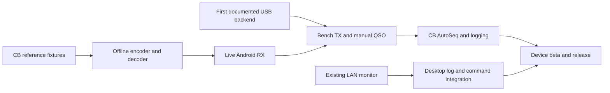

# Product and pull request roadmap

Build an English Android FT8 client for 27 MHz that can complete and log a QSO
without a PC, using phone microphone/speaker with radio VOX or a documented USB
OTG radio/audio setup. Keep a separate WSJT-CB LAN companion mode. Use FT8CN as
an operating-feature reference; compatibility decisions come from WSJT-CB.

This is a proposed delivery sequence, not a list of implemented features or a
schedule. `R01`–`R32` are planning IDs, not GitHub PR numbers. Split any item that
cannot deliver one reviewable behavior. Engine and hardware feasibility determine
later estimates; do not promise a complete Android port in one PR.

## Starting point

- Available on main: Android/Compose skeleton, JVM contracts, CB callsign
  validation, persistent station identity, UDP heartbeat/status and CI debug APK.
- [PR #14](https://github.com/vash909/8CBdroid/pull/14) is merged: LAN Decode/Clear,
  explicit Replay, bounded history and English-only resources. CI passed and the
  owner confirmed successful app testing and approved the merge on 2026-11-04.
- [PR #15](https://github.com/vash909/8CBdroid/pull/15) is merged: USB discovery
  and explicit access requests (R01a). The owner confirmed app testing and approved
  merge on 2026-11-05. Physical OTG/CAT interoperability remains unverified.
- Local DSP, microphone capture, playback, CAT/PTT and QSO logging are pending.
  Existing validators and FT8 constants are not an encoder or decoder.

## Reference strategy: reuse the CB work

Pin WSJT-CB to `94f776d54946fe43db5e0bb9c966b1595c7b7d97`, as in
[the LAN contract](WSJT_CB_INTEGRATION.md). Base CB behavior on its implementation
and regression tests, then identify its differences from WSJT-X. Do not derive
CB rules from FT8CN's amateur callsign handling.

R03 must produce a versioned difference inventory with source locations,
reference revisions, expected Android behavior and executable fixtures:

| Area | Shared FT8 foundation | CB behavior to preserve |
| --- | --- | --- |
| Waveform and channel coding | Slot timing, symbols, synchronization, CRC, LDPC and modulation | Compare generated signals with the pinned desktop; retain rejection of invalid frames. |
| Callsigns | Message field and non-standard-call constraints | Full WSJT-CB grammar, numeric/slash suffixes, leading zeros and complete/incomplete distinctions. |
| Message encoding | Packing/unpacking and hashed identities | Match actual CB message selection and type 4 handling in both hash orientations. Passing a regex does not prove encodability. |
| Decoder acceptance | Signal quality and integrity checks | Port relevant CB plausibility exceptions without weakening CRC or accepting arbitrary text as a peer. |
| QSO progression | CQ, reports, acknowledgements and completion | Match CB message generation, parsing fallbacks, selected-peer context and AutoSeq decisions. |
| Presentation and logs | UTC, frequency, locator and reports | Use CB numeric-prefix country lookup and preserve 27 MHz frequency/callsign data. |

The initial WSJT-CB snapshot is WSJT-X 3.0.0-rc1, as confirmed by the project
owner. Resolve its exact upstream commit and the relevant revision for each later
subsystem update. The pinned fork includes later decoder backports, so a diff
against current WSJT-X master alone cannot identify CB changes. Separate CB adaptations, upstream fixes
and desktop-only branding/build changes. Reuse unchanged algorithms where
practical; port only the Android-facing integration and the necessary CB changes.

Compare results from the real desktop implementation with Android/JVM outputs;
round-tripping an Android encoder through its own decoder is insufficient.
Keep fixture provenance, generator version, expected results and redistribution
notices. Include valid and invalid calls, unresolved hashes, ambiguous messages,
wrong peers, corrupted frames and full exchanges. Document deliberate differences.

## Milestones and dependencies

The next hardware PR follows the existing development sequence. Offline engine
work can continue if hardware is temporarily unavailable, but hardware support
cannot be declared verified until that exact phone/radio/cable combination passes.
LAN improvements must not replace the standalone Android engine.

## A. Establish hardware and interoperability references

R01 is split into R01a (USB discovery/permission, merged as PR #15) and
R01b (the first documented read-only CAT connection). Following the owner's
request, use FT8CN's Java USB serial approach. An OTG adapter and the exact
radio/cable/phone are not available yet, so R01 remains incomplete. See
[the USB CAT guide](USB_CAT.md) for scope and verification. R02 follows the real
radio configuration from R01b; independent R03 reference work can proceed meanwhile.

R03 is split into R03a (current PR: difference inventory and generated desktop
predicate fixtures), R03b (production packing/hash fixtures), and R03c (message
parser/generation and AutoSeq traces). See [the compatibility inventory](WSJT_CB_COMPATIBILITY.md).
R03a covers text predicates only, so R03 and R04's compatibility prerequisites
remain incomplete. R01b/R02 resume when the real radio configuration is known.

| ID / proposed PR title | Deliverable | Acceptance evidence / dependency |
| --- | --- | --- |
| R01 — Connect the first USB CAT radio | Select one radio/cable/phone, choose Hamlib/JNI or an Android CAT driver, and implement permission, connect, identity/frequency read and detach behind `RadioController`. Document VID/PID, protocol, baud rate and supported operations. | Transport fixtures plus physical connect/read/unplug tests. No transmission. A spike must resolve dependency/NDK feasibility before claiming support. |
| R02 — Save operating profiles | Persist chosen connection, radio settings, dial frequency, audio-route preference and LAN endpoint settings, with validation and migration. Restore configuration with sessions stopped and TX disarmed. | Persistence/reopening/failure tests; reconnect remains explicit. Depends on R01's configuration shape. |
| R03 — Capture WSJT-CB compatibility fixtures | Add the WSJT-CB versus WSJT-X inventory above and a reproducible desktop fixture generator/runner. Extend the current grammar tests from desktop cases. | Pinned sources and independently generated expected results. Include packing, hash, parser and AutoSeq cases; the desktop AutoSeq harness covers decisions, not the entire TX state machine. |
| R04 — Run a candidate FT8 engine on Android | Select and pin a reusable engine after testing CB extensibility, Android toolchain, licenses, memory and ARM performance. Replace string-only DSP results with typed messages, timing and decode metadata. | One real offline encode/decode smoke on an ARM64 phone and reproducible CI build. Record NDK/ABI and transitive dependencies. Depends on R03; engine choice remains open until evidence exists. |

A lightweight C/C++ engine and a port of relevant WSJT-CB routines are candidates,
not interchangeable guarantees. Reject a candidate that cannot reproduce the CB
fixtures. Hamlib selection concerns radio control, not the FT8 DSP engine; CAT
and USB audio must remain separate capabilities.

## B. Reach useful standalone reception

| ID / proposed PR title | Deliverable | Acceptance evidence / dependency |
| --- | --- | --- |
| R05 — Encode and unpack CB messages | Implement deterministic message selection and bit payloads for supported CQ, directed, report, acknowledgement and free-text paths. Report unsupported encodings explicitly. | Payload comparison against R03, including two long CB calls. Depends on R04. |
| R06 — Resolve CB callsign hashes | Add learned-call storage, session scope and explicit unresolved/ambiguous identities; handle both type 4 orientations. | Desktop hash fixtures and cold/warm-cache cases. Unknown identities never become invented full calls. Depends on R05. |
| R07 — Generate FT8 PCM offline | Generate tones and correctly shaped PCM through the selected engine, with explicit sample rate, offset and level. | Desktop decodes generated audio; compare symbols, duration and spectral output. No radio output. Depends on R05–R06. |
| R08 — Decode recorded FT8 slots | Decode WAV/PCM fixtures into typed results with UTC context, SNR, delta time, offset and flags, preserving CB acceptance rules. | Clean/noisy CB fixtures and corrupt-frame rejection against the desktop. Depends on R04–R06. |
| R09 — Bound decoder cost on a phone | Add cancellation, bounded work queues and measured decode profiles suitable for Android. Define a baseline phone and a minimum reception corpus. | Published latency, memory, sensitivity/false-positive and thermal measurements; no claim of desktop decoder parity without benchmarks. Depends on R08. |
| R10 — Capture phone audio | Implement microphone permission, selected-device capture, levels/clipping, buffering and resampling to DSP PCM. Expose actual route and processing settings. | Recorded signal/reference-tone checks on a phone; permission denial, interruption and route-loss recovery. Does not yet transmit. |
| R11 — Assemble UTC receive slots | Timestamp audio, assemble complete 15-second windows and handle missing samples, clock changes and drift. Expose measured/manual time correction without changing the Android system clock. | Deterministic clock/buffer tests and recordings across slot boundaries. Discard incomplete windows. Depends on R10. |
| R12 — Display live local decodes | Connect capture, slot assembly and decoder; distinguish local reception from LAN data and prevent stale results after Stop/restart. | A phone decodes desktop-generated CB audio and resumes cleanly after interruption. Depends on R08–R11. |
| R13 — Add spectrum and waterfall controls | Display levels, spectrum and waterfall with decoded-signal markers, bounded history, zoom and RX/TX offset selection. Keep display work separate from DSP. | Frequency-axis checks with reference tones, usable controls and sustained rendering on the baseline phone. Depends on R10/R12. |

**Receive milestone:** the phone independently receives CB FT8 from recorded and
live audio with measured limitations. A LAN decode list alone does not satisfy it.

## C. Complete a manually controlled QSO

| ID / proposed PR title | Deliverable | Acceptance evidence / dependency |
| --- | --- | --- |
| R14 — Preview generated audio | Play R07 PCM into an explicitly selected test output with level/ramp controls, cancellation and audio-focus handling. Keep live radio TX disabled. | Capture/loopback verifies level, sample rate and complete waveform; stop and route changes cancel playback. Depends on R07. |
| R15 — Schedule TX on UTC slots | Implement even/odd periods, queued-message snapshots, measured output latency and missed-deadline cancellation. Never send a stale message after a late decode or clock jump. | Virtual-clock tests and measured audio onset on a phone. Depends on R11/R14; still bench-only. |
| R16 — Coordinate CAT PTT and playback | Add frequency/mode verification where supported, PTT lead/tail timing, transmit interlocks, Stop TX and bounded watchdog behavior for the first radio. | Bench tests cover cancellation, CAT timeout and cable loss; document best-effort PTT release and the radio's own timeout behavior. Depends on R01/R15. |
| R17 — Support acoustic VOX operation | Add explicit phone speaker/microphone route, level calibration, VOX lead/tail timing and receive recovery. Avoid unwanted audio processing where the device permits it. | A documented radio VOX setup keys, carries the complete waveform and releases across repeated cycles. Depends on R12/R15; requires no CAT. |
| R18 — Support the first USB audio interface | Select USB input/output independently of CAT, negotiate hardware rate, calibrate latency/levels and stop on detach. Support the documented hub/power/cable arrangement. | Physical RX/TX audio tests with the selected interface and R16 controller. Do not infer USB audio support from a working serial cable. |
| R19 — Operate a manual CB exchange | Select a decoded peer, edit encodable messages, choose period and TX offset, tune with a bounded test tone, arm TX explicitly and halt immediately. Keep one session owner for local versus LAN operation. | Full manually stepped exchange with WSJT-CB on the bench through VOX and the documented USB setup. Depends on R05–R07/R12–R18. |
| R20 — Verify two-way desktop interoperability | Add reproducible end-to-end scenarios and fix defects in message/audio/session integration. | Cold/warm hash sessions, numeric/slash suffixes, both call orientations and weak/noisy audio; no false completion on an unrelated final message. Depends on R19. |

**Manual-QSO milestone:** real Android RX/TX works through both required connection
paths. Automated sequencing stays unavailable until its domain tests pass.

## D. Add CB QSO automation and a durable log

| ID / proposed PR title | Deliverable | Acceptance evidence / dependency |
| --- | --- | --- |
| R21 — Model CB QSO progression | Implement a pure JVM state machine for selected peer, CQ/reply, reports, acknowledgement, signoff, abort and completion. Keep RF execution outside it. | Event traces derived from WSJT-CB message generation/parsing, including its long-call exchange. Distinguish observed/received/sent events. Depends on R03/R20. |
| R22 — Match WSJT-CB AutoSeq decisions | Connect qualified local decodes to progression and next-message selection. Preserve addressed report/final handling and selected-peer context. | Differential fixtures for unresolved calls, wrong peer, duplicate/out-of-order reports, partner replying elsewhere and finals after completion. Desktop decision tests are supplemented with complete exchange traces. Depends on R21. |
| R23 — Run opt-in automated exchanges | Execute state-machine decisions through the existing scheduler, with explicit CQ/answer controls, retry limits, no-response timeout and operator override. | Scripted lost/repeated-message scenarios and full bench QSOs; Stop cancels queued audio/PTT and automation does not silently restart. Depends on R15–R16/R22 and the selected audio route. |
| R24 — Show CB operating context | Add pinned numeric-prefix country data, selected-peer locator/distance when known, CQ/directed/worked filters and clear unknown values. | Prefix cases compared with WSJT-CB, including leading zeros and unknown divisions. Do not substitute amateur DXCC parsing. Depends on R12/R21. |
| R25 — Save completed QSOs | Add a durable local log with UTC times, station/peer, locator, actual frequency, reports, mode and origin. Support review/edit/search and distinguish manual entries. | Transaction/restart/migration tests; one completion yields one record. Abort is not success. Depends on R21–R23. |
| R26 — Exchange ADIF logs | Add import/export/share through Android file APIs, backup/restore, duplicate review and malformed-record reporting. | ADIF fixtures and WSJT-CB round trips preserve CB calls and actual frequency; define handling for consumers that reject an 11m band label. Depends on R25. |

**Standalone MVP:** reception, manual and automatic CB QSOs, both documented audio
paths and a recoverable log work offline. Cloud accounts are not required.

## E. Complete LAN operation and release a supported product

| ID / proposed PR title | Deliverable | Acceptance evidence / dependency |
| --- | --- | --- |
| R27 — Import desktop LAN log events | Parse supported QSO/LoggedADIF payloads and add source-tagged records to the common log, with duplicate protection. | Schema-specific date/time fixtures and real desktop events. Never turn a received Decode into a completed QSO. Depends on R25–R26 and the LAN decode PR. |
| R28 — Control supported desktop actions | Add focused Reply/Halt TX flows only where the pinned API supports them, with desktop request permission and visible TX state. Split additional commands into separate PRs. | Exact wire fixtures and real-desktop tests; stale/replayed decodes cannot accidentally trigger Reply. Local and desktop transmit sessions are mutually exclusive. Depends on R27 and a protocol audit. |
| R29 — Keep an explicit session running | Add a user-started foreground operating service with persistent session/Stop notification and appropriate microphone/network lifecycle handling for supported Android versions. | Screen-off, background, permission revocation, audio focus, USB detach and process-recreation tests on devices. TX never rearms after process recreation. Depends on R23 and session ownership in R19. |
| R30 — Diagnose sustained operation | Add opt-in bounded diagnostics, exportable session reports and receive/decode timing statistics; tune measured thermal/battery regressions. | A sustained-session report on baseline and second phone, with permissions and user-controlled diagnostic deletion. Depends on R09/R29. |
| R31 — Qualify the release candidate | Run the supported-device/radio matrix and finish English setup, calibration, troubleshooting and accessible operating controls. Fix release-blocking defects in focused follow-up PRs. | Published device/OS/radio/cable evidence for local VOX, USB and desktop LAN. Include upgrade/restore, large text, offline and disconnect tests. Depends on R20/R26–R30. |
| R32 — Package a reproducible release | Add protected release signing, versioned release APK, upgrade checks, dependency/license inventory and matching Corresponding Source/build instructions. | Clean-environment release build and install/upgrade on supported phones; signing material stays outside Git. Apply the existing commercial-distribution policy. Depends on R31. |

**Version 1.0:** the supported configurations complete repeated interoperable CB
QSOs, recover from operational failures, preserve logs across upgrades and ship
with reproducible source/build information. Broader hardware coverage is earned
one tested backend at a time, not implied by using Hamlib.

## Extensions after the core product

Each extension gets its own compatibility review and focused PRs:

- Additional radios, USB interfaces and serial adapters, each with device tests.
- Bluetooth CAT/audio or network-radio audio, after measuring latency and routing.
  WSJT-CB's existing UDP protocol does not transport audio.
- Optional spotting and external log integrations only after verifying service
  support for 27 MHz and CB identities; no assumption that amateur services accept them.
- Maps, optional location-derived locator, CB division statistics and confirmations.
- More advanced decoder depth, multi-pass cancellation and additional performance
  profiles, supported by sensitivity and false-positive measurements.
- Other modes, including FT4 or WSJT-CB WSPR, as separate projects after FT8.
  Their encoding and interoperability requirements must be evaluated independently.

## PR workflow and testing

Use short English PR titles/descriptions, one independently verifiable behavior
and explicit dependencies. Every code PR runs `bash scripts/check.sh`, any new
native/reference checks and GitHub Actions; add phone instructions when relevant.
JVM tests cover protocol/QSO decisions; device tests cover audio, permissions and
USB; bench interoperability covers real encoder/decoder and radio timing.

An emulator or green CI cannot establish acoustic VOX, USB/PTT or RF compatibility.
Record exact hardware and results. Before enabling live TX, verify the selected
route, scheduler and stop behavior on the bench. Keep the client, docs, comments,
commits and PRs in English. Preserve GPL-3.0-only and
[the commercial policy](COMMERCIAL_DISTRIBUTION.md).

After each PR and build, wait for the owner's explicit OK before merge. Update
this roadmap with verified milestone results; do not mark a feature complete
because its UI or contract exists.

## Sources inspected for this plan

The sequence above is an engineering proposal, not FT8CN's own roadmap.

- [FT8CN operating controls and features](https://github.com/N0BOY/FT8CN/blob/a98fbfaec379a0c7a07d2a50c27be223aef948d8/ft8cn/app/src/main/res/values/strings.xml): reference for RX/TX controls, spectrum, CAT/VOX, watchdogs and log workflows.
- [FT8CN waveform/message integration](https://github.com/N0BOY/FT8CN/blob/a98fbfaec379a0c7a07d2a50c27be223aef948d8/ft8cn/app/src/main/java/com/bg7yoz/ft8cn/ft8transmit/GenerateFT8.java): illustrates the separation between message handling and native signal generation; not a CB compatibility specification.
- [WSJT-CB changes from its WSJT-X base](https://github.com/vash909/WSJT-CB/blob/94f776d54946fe43db5e0bb9c966b1595c7b7d97/README.md): starting inventory to verify against code in R03.
- [WSJT-CB complete-call and type 4 predicates](https://github.com/vash909/WSJT-CB/blob/94f776d54946fe43db5e0bb9c966b1595c7b7d97/lib/ft8var/cb_callsigns.f90): CB acceptance rules and preserved integrity checks.
- [WSJT-CB regression harness](https://github.com/vash909/WSJT-CB/blob/94f776d54946fe43db5e0bb9c966b1595c7b7d97/tests/ft8/README.md): packing, decoder and concurrency fixtures, with stated test limits.
- [WSJT-CB AutoSeq decision tests](https://github.com/vash909/WSJT-CB/blob/94f776d54946fe43db5e0bb9c966b1595c7b7d97/tests/ft8/test_cb_autoseq.cpp): concrete admission, advancement and stop cases for differential validation.
